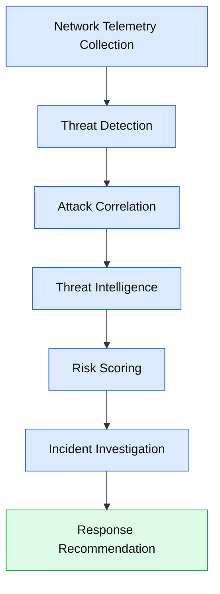
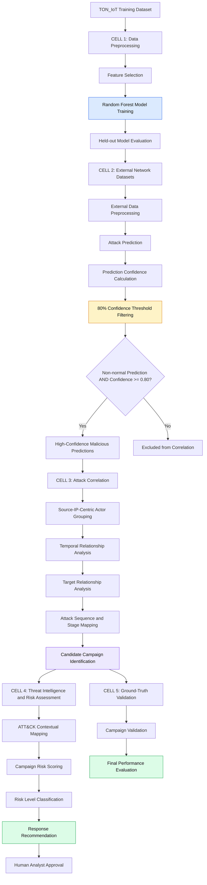
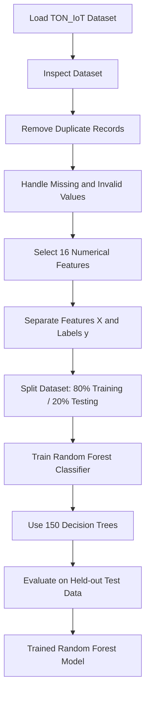
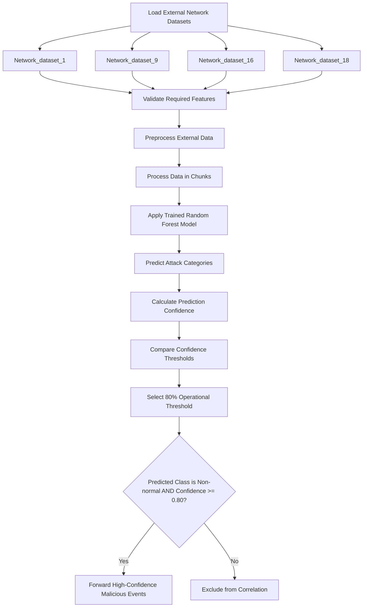
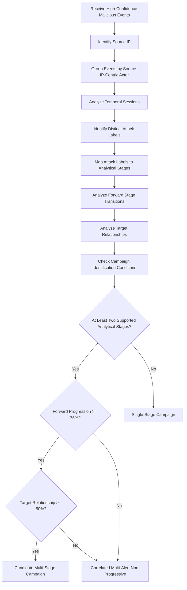
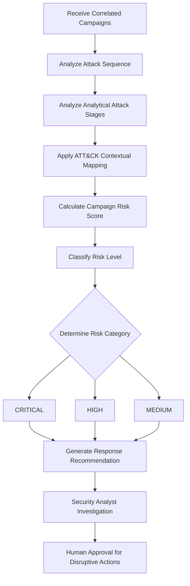
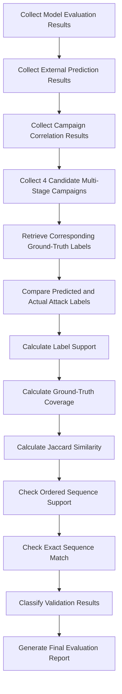
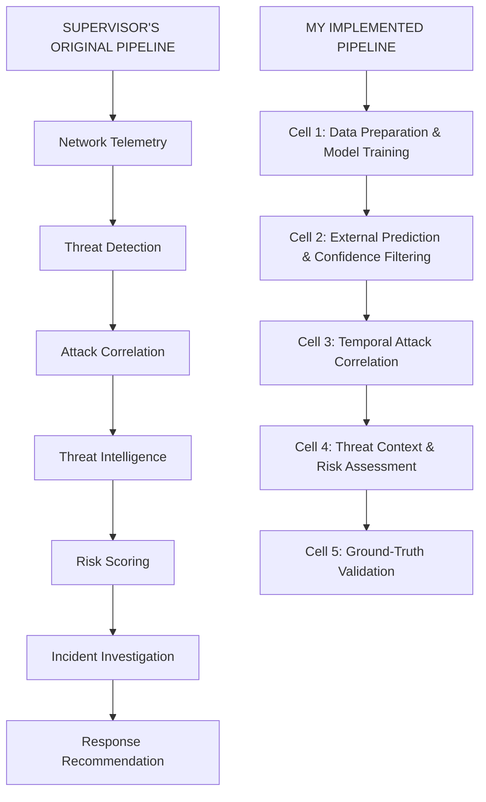

https://drive.google.com/drive/folders/1PNqM9q0_zNRsHsRyH_MIewQeSkgrQQ5o?usp=sharing

# AutoSOC — Autonomous Security Operations Center

### Machine Learning-Based Threat Detection, Attack Correlation, Campaign Investigation & Risk Assessment

---

## 1. Project Overview

AutoSOC is a security operations framework designed to detect malicious network activities, correlate related attack events, identify potential multi-stage attack campaigns, assess security risks, and generate response recommendations.

This project follows two major pipeline perspectives:

1. **Supervisor's Original Pipeline:** The conceptual workflow defining the overall AutoSOC architecture.
2. **My Implemented Pipeline:** A practical five-cell implementation that extends the original workflow with Machine Learning, confidence-based filtering, temporal correlation, campaign analysis, risk assessment, and ground-truth validation.

The objective is to transform individual network alerts into meaningful campaign-level security insights.

---

# 2. Supervisor's Original Pipeline

The supervisor provided the initial conceptual methodology of the AutoSOC system.

## Original Methodology — Vertical Flowchart

## Explanation of the Original Pipeline

| Stage | Explanation |
|---|---|
| Network Telemetry | Collect network traffic and event information. |
| Threat Detection | Detect potentially malicious network activities. |
| Attack Correlation | Identify relationships among different attack events. |
| Threat Intelligence | Enrich detected threats with relevant security context. |
| Risk Scoring | Calculate the risk associated with detected threats. |
| Incident Investigation | Investigate suspicious activities and possible attack patterns. |
| Response Recommendation | Recommend suitable security responses. |

### Main Concept

The supervisor's pipeline defines the overall workflow of an Autonomous Security Operations Center.

It describes how the system should move from network telemetry collection to threat detection, investigation, risk assessment, and response recommendation.

---

# 3. My Implemented AutoSOC Pipeline

To implement the supervisor's conceptual workflow, I organized the practical work into five major cells.

Each cell performs a specific operation and passes its output to the next stage.

## Complete Implementation — Vertical Flowchart

---

# 4. Cell-by-Cell Methodology

## CELL 1 — Data Preprocessing & Model Training

**Objective:** Prepare the TON_IoT dataset and train a Machine Learning model to classify network attacks.

### Methodology Flowchart

### Results

| Metric | Value |
|---|---:|
| Original Records | 211,043 |
| Duplicate Records Removed | 20,569 |
| Cleaned Records | 190,474 |
| Selected Features | 16 |
| Training/Test Ratio | 80:20 |
| Decision Trees | 150 |
| Held-out Accuracy | 98.74% |

**Output:** A trained Random Forest model used in Cell 2.

---

## CELL 2 — External Prediction & Confidence-Based Filtering

**Objective:** Apply the trained model to external network datasets and select high-confidence malicious predictions.

### Methodology Flowchart

### External Datasets

- Network_dataset_1
- Network_dataset_9
- Network_dataset_16
- Network_dataset_18

### Confidence Threshold Comparison

| Threshold | Agreement | Coverage |
|---|---:|---:|
| 70% | 89.88% | 45.54% |
| 80% | 93.07% | 41.57% |
| 90% | 95.08% | 37.47% |

### Results

| Metric | Value |
|---|---:|
| Overall External Agreement | 56.30% |
| Selected Threshold | 80% |
| Agreement at 80% | 93.07% |
| Coverage at 80% | 41.57% |
| Forwarded Malicious Predictions | 1,253,175 |

**Why 80%?**

A higher confidence threshold improves agreement among selected evaluated events but reduces coverage. Therefore, 80% was selected as an operational balance.

**Output:** 1,253,175 non-normal predictions with confidence of at least 80%.

These are model-predicted malicious events, not independently confirmed attacks.

---

## CELL 3 — Robust Attack Correlation & Temporal Reasoning

**Objective:** Correlate related malicious network events and identify potential multi-stage attack campaigns.

### Methodology Flowchart

### Correlation Methodology

The system analyzes relationships using:

1. **Source IP:** Groups events associated with the same source actor.
2. **Temporal Relationship:** Examines when events occur and their relationship within a temporal session.
3. **Target Relationship:** Checks whether adjacent attack labels have supporting target overlap.
4. **Attack Stage Mapping:** Maps predicted attack labels to analytical stages.
5. **Progression Analysis:** Evaluates whether events demonstrate meaningful forward stage progression.

### Candidate Multi-Stage Conditions

- Same source actor within one temporal session.
- Multiple attack labels with meaningful event support.
- At least two distinct analytical stages.
- At least 75% forward stage-transition evidence.
- Final meaningful stage occurs later than the first.
- At least 50% adjacent attack labels share target evidence.

### Results

| Metric | Value |
|---|---:|
| Input Malicious Events | 1,253,175 |
| Total Campaigns | 2,576 |
| Candidate Multi-Stage | 4 |
| Non-Progressive Multi-Alert | 15 |
| Single-Stage | 2,557 |
| Flow-to-Campaign Compression | 99.79% |

### Candidate Multi-Stage Campaigns

| Source IP | Predicted Sequence | Analytical Stages |
|---|---|---|
| 192.168.1.31 | XSS → DDoS | Initial Access → Impact |
| 192.168.1.194 | Scanning → Ransomware | Reconnaissance/Discovery → Impact |
| 192.168.1.190 | Scanning → Ransomware | Reconnaissance/Discovery → Impact |
| 192.168.1.133 | Scanning → Ransomware | Reconnaissance/Discovery → Impact |

**Output:** 2,576 correlated campaigns, including 4 candidate multi-stage campaigns.

A candidate campaign indicates a possible attack progression, not confirmed causal attack behavior.

---

## CELL 4 — Threat Intelligence, Risk Assessment & Response

**Objective:** Enrich correlated campaigns with security context, calculate risk scores, classify risk levels, and recommend responses.

### Methodology Flowchart

### Risk Assessment Examples

| Source IP | Attack Sequence | Risk Score | Risk Level |
|---|---|---:|---|
| 192.168.1.31 | XSS → DDoS | 91.73 | CRITICAL |
| 192.168.1.194 | Scanning → Ransomware | 86.06 | CRITICAL |
| 192.168.1.190 | Scanning → Ransomware | 85.52 | CRITICAL |
| 192.168.1.133 | Scanning → Ransomware | 83.15 | CRITICAL |
| 192.168.1.30 | DDoS → XSS | 71.61 | HIGH |
| 192.168.1.184 | XSS → Injection | 44.41 | MEDIUM |

### Response Recommendations

| Risk Level | Recommendation |
|---|---|
| CRITICAL | Urgent analyst approval required |
| HIGH | Analyst review required |
| MEDIUM | Passive monitoring and review |

**Output:** Campaign risk scores, risk classifications, and response recommendations.

The framework recommends security actions but does not automatically execute disruptive actions. Human analyst approval is required.

---

## CELL 5 — Ground-Truth Validation & Final Evaluation

**Objective:** Evaluate the overall framework and validate the candidate multi-stage campaigns using ground-truth labels.

### Methodology Flowchart

### Model Evaluation

| Metric | Value |
|---|---:|
| Accuracy | 98.74% |
| Macro Precision | 0.965 |
| Macro Recall | 0.971 |
| Macro F1 | 0.968 |
| Weighted Precision | 0.988 |
| Weighted Recall | 0.987 |
| Weighted F1 | 0.987 |

### Campaign Ground-Truth Validation

| Source IP | Predicted Sequence | Ground Truth | Validation |
|---|---|---|---|
| 192.168.1.31 | XSS → DDoS | None | No Ground-Truth Attack Support |
| 192.168.1.194 | Scanning → Ransomware | Scanning | Partial Ground-Truth Support |
| 192.168.1.190 | Scanning → Ransomware | Scanning | Partial Ground-Truth Support |
| 192.168.1.133 | Scanning → Ransomware | Scanning | Partial Ground-Truth Support |

### Validation Metrics

| Metric | Value |
|---|---:|
| Candidates Validated | 4 |
| Average Label Support | 37.50% |
| Average Ground-Truth Coverage | 75.00% |
| Average Jaccard Similarity | 37.50% |
| Ordered Sequence Support | 0 |
| Exact Sequence Match | 0 |

### Final Interpretation

- 3 campaigns received partial ground-truth support.
- 1 campaign received no ground-truth attack support.
- None of the 4 campaigns achieved an exact sequence match.

**Output:** Final model metrics, external evaluation, campaign validation, and performance reports.

---

# 5. Supervisor's Pipeline vs. My Implemented Pipeline

The implemented pipeline follows the original conceptual architecture but introduces detailed technical operations and measurable evaluation stages.

## Comparison Flowchart

## Detailed Comparison

| Supervisor's Pipeline | My Implementation |
|---|---|
| Network Telemetry | TON_IoT training data and external network datasets |
| Threat Detection | Random Forest classification and confidence filtering |
| Attack Correlation | Source-IP-centric temporal and target relationship analysis |
| Threat Intelligence | ATT&CK contextual mapping |
| Risk Scoring | Campaign-level risk scoring and classification |
| Incident Investigation | Campaign analysis and ground-truth validation |
| Response Recommendation | Analyst-oriented response recommendation |

### What Was Extended in My Implementation?

| Component | Implementation |
|---|---|
| Data Preparation | Duplicate removal, feature selection, and preprocessing |
| Threat Detection | Random Forest with 150 decision trees |
| Confidence Filtering | Operational threshold of 80% |
| Attack Correlation | Source IP, time, and target relationships |
| Campaign Identification | Multi-stage, non-progressive, and single-stage classification |
| Risk Assessment | Campaign-level risk score and risk classification |
| Validation | Ground-truth label, coverage, Jaccard, and sequence comparison |

### Main Difference

The supervisor's pipeline defines **what the AutoSOC framework should do**.

My implemented pipeline explains **how those operations are practically performed, evaluated, and connected** through five implementation stages.

Therefore, my pipeline is a practical implementation and extension of the supervisor's original methodology.

---

# 6. Overall Project Results

| Component | Key Result |
|---|---|
| Training Dataset | 190,474 cleaned records |
| Machine Learning Model | Random Forest |
| Held-out Accuracy | 98.74% |
| External Overall Agreement | 56.30% |
| Operational Confidence Threshold | 80% |
| High-Confidence Agreement | 93.07% |
| High-Confidence Coverage | 41.57% |
| Forwarded Predictions | 1,253,175 |
| Correlated Campaigns | 2,576 |
| Candidate Multi-Stage Campaigns | 4 |
| Non-Progressive Campaigns | 15 |
| Single-Stage Campaigns | 2,557 |
| Partial Ground-Truth Support | 3 candidates |
| Exact Sequence Match | 0 |

---

# 7. Technologies & Methods

| Category | Technology / Method |
|---|---|
| Programming Language | Python |
| Dataset | TON_IoT |
| Machine Learning | Random Forest |
| Data Processing | Pandas, NumPy |
| Model Evaluation | Scikit-learn |
| Prediction Confidence | `predict_proba()` |
| Attack Correlation | Source IP, temporal and target relationships |
| Threat Context | ATT&CK-related contextual mapping |
| Validation | Ground-truth comparison |
| Visualization | Mermaid Flowcharts and Analytical Tables |

---

# 8. Generated Reports

| Report | Description |
|---|---|
| `AutoSOC_UPDATED_Final_Report.csv` | Campaign-level analysis and risk assessment |
| `AutoSOC_UPDATED_GroundTruth_Validation.csv` | Candidate campaign validation |
| `AutoSOC_UPDATED_Final_Metrics.csv` | Final performance metrics |

---

# 9. Important Research Considerations

- Model predictions are not automatically confirmed attacks.
- Correlated events do not automatically prove a causal attack chain.
- Candidate multi-stage campaigns require independent validation.
- Ground truth is used for evaluation after prediction and correlation.
- ATT&CK mapping provides contextual enrichment, not a complete threat-intelligence feed.
- Risk scores support investigation prioritization but do not independently prove malicious intent.
- Response recommendations require human analyst oversight.
- The 98.74% held-out accuracy, 56.30% overall external agreement, and 93.07% high-confidence agreement represent different evaluation settings.

---

# 10. Conclusion

This project implements an extended AutoSOC workflow based on the supervisor's original conceptual pipeline.

The implementation consists of five stages:

1. Data preprocessing and Random Forest model training.
2. External attack prediction and confidence-based filtering.
3. Temporal attack correlation and candidate campaign identification.
4. Threat context enrichment, campaign risk assessment, and response recommendation.
5. Ground-truth validation and final performance evaluation.

The major contribution is the transition from individual malicious event detection to campaign-level analysis using source IP, temporal relationships, target evidence, and analytical attack stages.

The evaluation identified four candidate multi-stage campaigns. Three received partial ground-truth support, while one received no support. None achieved an exact sequence match.

The framework therefore provides a structured foundation for threat detection, campaign investigation, and risk prioritization while preserving human analyst oversight.

---

**Project:** AutoSOC  
**Architecture:** Supervisor-Defined Conceptual Pipeline + Five-Cell Implementation  
**Status:** Implementation and evaluation completed.

10. Autonomous Cyberattack Detection + Response
Proposed Title

AutoSOC: An Autonomous Cyber Threat Detection, Investigation, and Response Framework

এটা সবচেয়ে ambitious idea।

Traditional SOC:
Alert
 ↓
Human Analyst
 ↓
Investigation
 ↓
Decision
 ↓
Response

আপনার:

Telemetry
    ↓
Threat Detection
    ↓
Attack Correlation
    ↓
Threat Intelligence
    ↓
Risk Scoring
    ↓
Incident Investigation
    ↓
Response Recommendation
Multiple attacks correlate করা হবে

Example:

Port Scan
   ↓
Brute Force
   ↓
Credential Compromise
   ↓
Privilege Escalation
   ↓
Lateral Movement
   ↓
Data Exfiltration

একেকটা event আলাদা alert না হয়ে:

একটি multi-stage attack campaign

হিসেবে detect করা।

Research novelty

Attack correlation + temporal reasoning + automated response recommendation

I selected the TON_IoT network dataset. The original dataset contained 211,043 records. During data cleaning, I detected 20,569 exact duplicate records. I applied duplicate removal as my preprocessing technique, resulting in 190,474 unique records. Then I used a Random Forest classifier on the numerical network features. Using an 80–20 train-test split, the model achieved 99.83% accuracy.

Why Duplicate Removal?
“Because my dataset actually contained 20,569 duplicate records. Repeated samples can give unnecessary extra importance to the same observations and may bias model training, so I removed them.”

Data_Set_LINK : [https://unsw-my.sharepoint.com/personal/z5025758_ad_unsw_edu_au/_layouts/15/onedrive.aspx?id=%2Fpersonal%2Fz5025758%5Fad%5Funsw%5Fedu%5Fau%2FDocuments%2FTON%5FIoT%20datasets&ga=1](https://research.unsw.edu.au/projects/unsw-nb15-dataset?utm_source=chatgpt.com)

My_Preprocessing_Dataset : https://unsw-my.sharepoint.com/personal/z5025758_ad_unsw_edu_au/_layouts/15/onedrive.aspx?id=%2Fpersonal%2Fz5025758%5Fad%5Funsw%5Fedu%5Fau%2FDocuments%2FTON%5FIoT%20datasets%2FTrain%5FTest%5Fdatasets%2FTrain%5FTest%5FNetwork%5Fdataset&viewid=f8d1dec5%2Dcd5f%2D42ae%2D8b06%2D2fece580c74a&ga=1

Dataset_Drive_Link : https://drive.google.com/drive/folders/17fSpEnaHKGzf3uYIhe2iFfmAVFyRj7p1?usp=sharing
